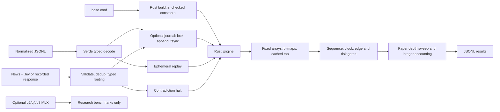
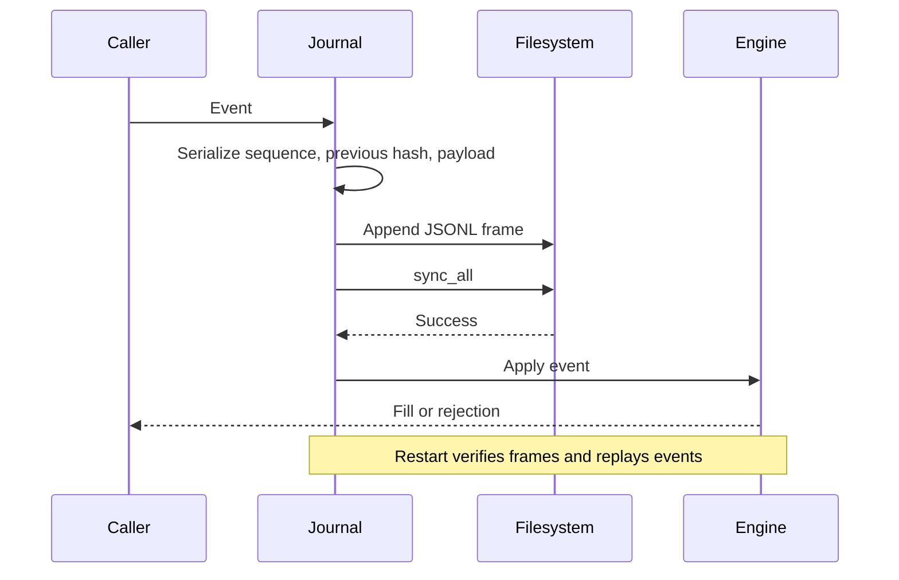
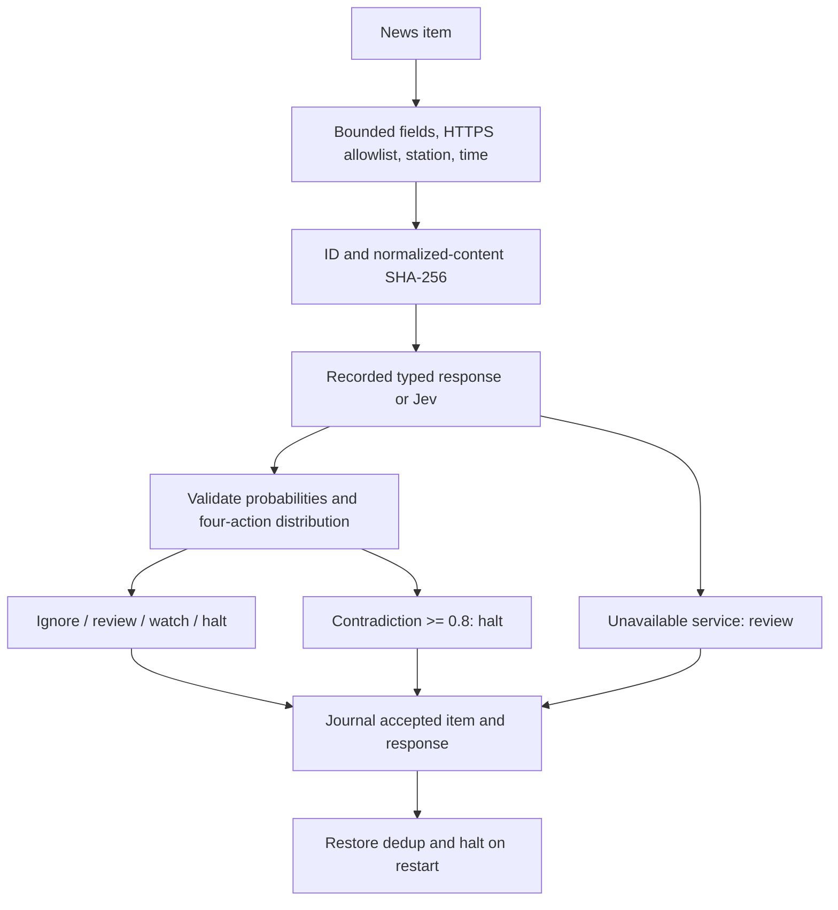

# Architecture

The Rust Engine owns books, inventory, cash, clocks, limits and halts. Callers serialize events through one owner. The CLI reads ordered JSONL; it does not serve authenticated feeds or submit transactions.

## Execution

Prices and cash are integer millionths of a dollar; size is whole shares. Tick sizes must divide 1,000,000 and fit 1,001 levels. Sixteen occupancy words skip empty levels. A sequence gap or crossed update disables trading until a valid snapshot. Replay sequences are a normalized input contract; a future feed adapter must implement continuity and reconnect semantics.

FAK sweeps take eligible depth in price order and stop at fee-adjusted edge, cash, city cost, order and inventory limits. Rebalance buys or sells the difference from a target holding, without shorts. The reverse fixture intentionally loses money.

Session loss checks combine realized loss with conservative liquidation equity against initial cash. Only fresh bid depth after fees has value; missing, stale or unsellable holdings contribute zero. A loss halt blocks buys but allows exits. Operator/news halts block both directions. No daily reset scheduler exists.

## Journal protocol

The first frame stores versioned configuration. Restart verifies sequence, SHA-256 chain and record order. Only a newline-less final record is truncated; complete corrupt frames fail closed. Rejected events are replayed because their clock/rate/halt effects matter. Prefix hashes let durable-replay skip already recorded input and reject divergence. Direct Journal::apply callers must implement their own idempotence.

The file lock permits one cooperating writer. Write/sync errors poison the writer until restart. Hashes detect accidental corruption, not malicious rewriting. fsync is used, not macOS F_FULLFSYNC; hardware power-loss durability is unverified. Recovery scans the whole journal and retains event hashes: time and memory grow with history. Compaction and live fill reconciliation remain absent.

## News routing

The URL allowlist checks declared provenance; it does not fetch or authenticate content. Jev answers five probability questions and one action choice. Noul is a probability, not a separate confidence estimate. Action probabilities must sum to one and select a maximum. Uncertain evidence routes to review. No route authorizes orders.

The client uses a fixed HTTPS endpoint, no redirects, bounded responses and three total attempts for 429/529 with bounded delays. It can take tens of seconds and belongs outside any latency-sensitive event owner. The current CLI processes news separately. Invalid input and service errors are printed; service errors are not journal records.
