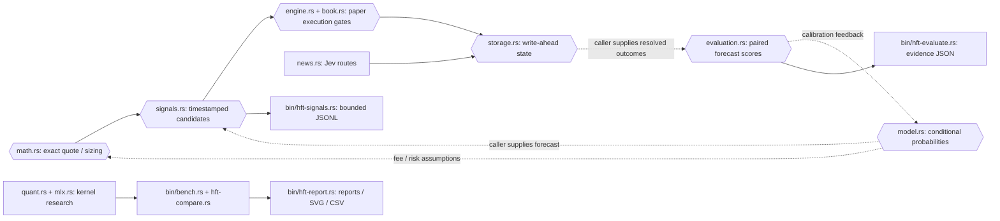

# Rust source map

This polygon-shaped source map describes the Rust modules and research workflow. Blockchain policy remains Base mainnet only; the diagram does not enable Polygon settlement.

Solid arrows show supported data flow. Dashed arrows require caller-supplied forecasts/outcomes or an offline calibration step. Journal records do not include resolved outcomes; no outcome-fetching pipeline is implied.

| Source | Responsibility |
|---|---|
| rust/src/math.rs | Checked fee/edge/Kelly and cash-fraction arithmetic |
| rust/src/signals.rs | Base-only candidate schema, provenance declarations, expiry and caps |
| rust/src/model.rs | Truncated-normal baseline and scoring primitives |
| rust/src/evaluation.rs | Equal-record forecast comparison and leakage/ID gates |
| rust/src/engine.rs, book.rs | Authoritative paper fill/risk state |
| rust/src/storage.rs | Single-writer journal and recovery |
| rust/tests/math_signals.rs | Golden math, boundary, integration and leakage tests |

First-party Rust forbids unsafe code. The optional native MLX binding contains upstream FFI and remains separately validated. The archived Python prototype is outside the active runtime.
