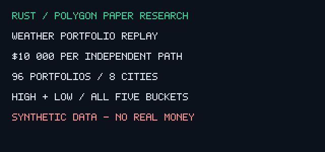

# Weather portfolios with $10,000 paper capital

Every independent scenario/seed starts with $10,000 shared across eight cities, daily highs and lows, and all five buckets. This is synthetic research, not a deposit or live trading.

The run has 96 portfolios (six scenarios × 16 seeds), 20 days each, 30,720 contracts and 153,600 bucket evaluations. Cities are NYC, London, Chicago, Seoul, Dallas, Atlanta, Miami and Toronto. These labels do not represent real city forecasts or current listed contracts.

| Scenario | Median P&L ($) | Worst P&L ($) | Orders, all seeds |
|---|---:|---:|---:|
| normal | -117.71 | -632.98 | 583 |
| biased_forecast | -1041.56 | -1509.04 | 3262 |
| fee_spike | +76.23 | -684.10 | 194 |
| thin | +0.00 | +0.00 | 0 |
| delayed | +0.00 | +0.00 | 0 |
| adverse_price | +0.00 | -184.95 | 9 |

The normal median portfolio lost $117.71; forecast bias lost substantially more. The fee-spike sample happens to have a positive median because it filters trades differently. That observation does not establish an advantage from higher fees. Thin and delayed inputs stop orders. No strategy is demonstrated profitable.

## Generate and replay

Run make weather-data, then sh scripts/weather-simulations.sh simulate. Run make release-gif to render the report with ffmpeg. Or run make weather-simulations for compact tests, generation and replay. make simulations separately runs execution stress.

Generator CLI: hft-weather generate <new-directory> [days:1..90] [seeds:1..32]. Defaults are 20 days and 16 seeds. It refuses to overwrite a dataset. Generation uses a 64-record queue; JSONL writing uses reusable buffers. Forecasts and resolutions are separate files. The report verifies their SHA-256 hashes and manifest counts before accepting results. SHA-256 provides integrity, not source authenticity.

All 16 city/metric decisions for a day finish before that day's resolutions are consumed. Daily outcomes cannot finance that day's orders. Days rotate contract processing order; city and daily caps still create ordering effects. Quarter Kelly uses fee-inclusive edge and a 0.03 probability uncertainty haircut. Limits: $100/order, $250/city/day, $500/day, one percent bankroll sizing cap, minimum five shares and at most 1,000 shares. Money uses checked integer arithmetic and conservative fees. Marks between daily settlements are absent, so drawdown is settlement-to-settlement.

The generator uses a simple conditional weather distribution shared with the probability model, perturbed forecasts and synthetic quote noise/spread. Its shared model family and constructed prices limit realism. Forecast-bias, increased fees, insufficient depth, stale quotes and adverse repricing stress the assumptions. No historical queue, calibrated meteorology, cancellation latency, gas, market-specific settlement disputes or portfolio correlation model is present. It does not simulate every real weather market.

Normal fee assumption: rate 0.05 in shares × rate × p × (1-p), rounded conservatively per share. Polymarket's [fee documentation](https://docs.polymarket.com/trading/fees) listed Weather at 0.05 when checked; actual live schedules must be queried per market. The simulator subtracts upfront cash fees rather than implementing the venue's net-share buy-fee settlement.

Full outcomes, daily equity, skips and data hashes: [weather-10000.json](../reports/weather-10000.json). Data is regenerated deterministically, not bundled in Git. The GIF is rendered by Rust from this report with ffmpeg as encoder; it shows every scenario, including losses.

## Build and backend gates

Make defaults to the compact correctness profile with one Cargo job and one shared target cache. Compact timings are diagnostic, not release performance evidence. HFT_PROFILE=release make bench creates a separately named artifact. Existing published optimized measurements are retained.

Preflight refuses builds below 128 MiB free; native MLX and release validation require at least 1 GiB. These are guard thresholds, not promises a fresh dependency build fits. Moving target to /private/tmp does not increase free capacity on the same volume. Free disk space before native builds; no personal data is deleted automatically. make install atomically copies built executables into .local/bin without reading possibly cloud-evicted Cargo install metadata. Already installed CLIs can run while builds are blocked.

MLX limits weight/input sizes and batch rows, selects streams explicitly, evaluates lazy output, validates shape, uses fallible readbacks and rejects nonfinite results. Native tests are feature-gated. This update's native check was blocked by disk preflight; it is not native MLX validation. CUDA remains uncompiled/unmeasured on this Apple host. The active CPU path is available; real order submission remains disabled.
