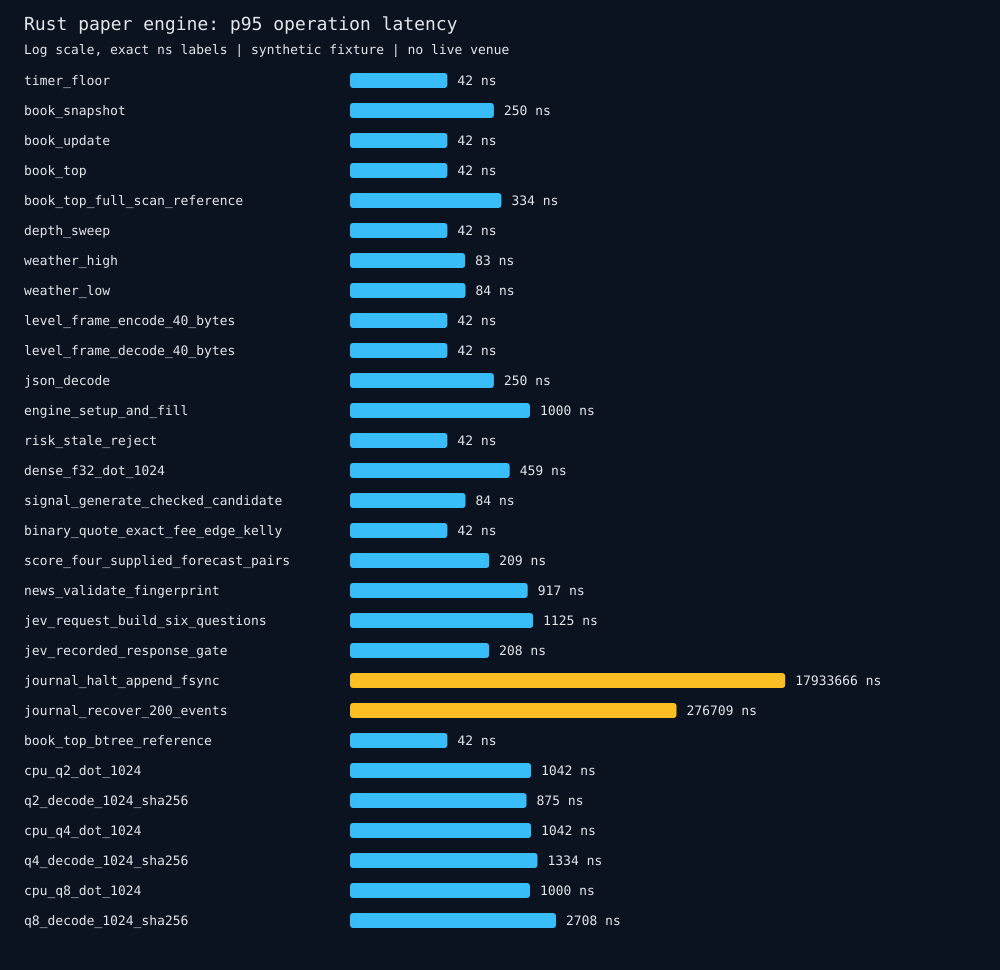

# Benchmarks

Rust 0.3.0, Apple ARM64, synthetic-v2. Default backend: native MLX disabled.

The chart uses a log scale; exact values are labeled. Sub-timer operations, including zero medians, are below measurement resolution. These are local synthetic operation timings, not live tick-to-trade latency or fund returns.

| Operation | Warmups | Samples | p50 ns | p95 ns | p99 ns |
|---|---:|---:|---:|---:|---:|
| timer_floor | 2000 | 20000 | 0 | 42 | 42 |
| book_snapshot | 2000 | 20000 | 417 | 500 | 500 |
| book_update | 2000 | 20000 | 41 | 42 | 42 |
| book_top | 2000 | 20000 | 0 | 42 | 42 |
| book_top_full_scan_reference | 2000 | 20000 | 500 | 584 | 625 |
| depth_sweep | 2000 | 20000 | 42 | 42 | 42 |
| weather_high | 2000 | 20000 | 125 | 166 | 167 |
| weather_low | 2000 | 20000 | 125 | 125 | 125 |
| json_decode | 2000 | 20000 | 417 | 500 | 542 |
| engine_setup_and_fill | 2000 | 20000 | 1208 | 1625 | 1750 |
| risk_stale_reject | 2000 | 20000 | 42 | 42 | 42 |
| dense_f32_dot_1024 | 2000 | 20000 | 500 | 500 | 542 |
| signal_generate_checked_candidate | 2000 | 20000 | 42 | 84 | 84 |
| binary_quote_exact_fee_edge_kelly | 2000 | 20000 | 0 | 42 | 42 |
| score_four_supplied_forecast_pairs | 2000 | 20000 | 167 | 209 | 209 |
| news_validate_fingerprint | 2000 | 20000 | 833 | 875 | 917 |
| jev_request_build_six_questions | 2000 | 20000 | 1000 | 1083 | 1125 |
| jev_recorded_response_gate | 2000 | 20000 | 167 | 167 | 208 |
| journal_halt_append_fsync | 100 | 100 | 3940208 | 5468375 | 7235083 |
| journal_recover_200_events | 100 | 100 | 311500 | 381708 | 430125 |
| book_top_btree_reference | 2000 | 20000 | 0 | 42 | 42 |
| cpu_q2_dot_1024 | 2000 | 20000 | 1000 | 1000 | 1042 |
| cpu_q4_dot_1024 | 2000 | 20000 | 959 | 1000 | 1042 |
| cpu_q8_dot_1024 | 2000 | 20000 | 959 | 1000 | 1042 |

## Storage versus dense f32

Packed affine reference weights include scales, biases and packing overhead. This is storage for the synthetic vector, not model-memory or accuracy superiority.

| Bits | Packed bytes | Dense bytes | Storage reduction | Absolute dot error |
|---|---:|---:|---:|---:|
| 2 | 384 | 4096 | 90.62% | 0.05687808990478515 |
| 4 | 640 | 4096 | 84.38% | 0.14974403381347656 |
| 8 | 1152 | 4096 | 71.88% | 0.04233837127685547 |

[Equal-output batched comparisons](MEASURED_COMPARISONS.md) report matched-round full-scan/BTree lookup results, including mixed cases.

## Native MLX CPU, optimized release

These operations include input creation, evaluation and readback. Batch rows process 32 vectors per call. Results measure kernels, not trained-model quality.

| Operation | Warmups | Samples | p50 ns | p95 ns | p99 ns |
|---|---:|---:|---:|---:|---:|
| mlx_q2_dot_1024_including_transfer_and_eval | 2000 | 2000 | 8292 | 9667 | 13333 |
| mlx_q2_batch32_including_transfer_and_eval | 2000 | 2000 | 44708 | 49542 | 52625 |
| mlx_q4_dot_1024_including_transfer_and_eval | 2000 | 2000 | 7500 | 8458 | 8958 |
| mlx_q4_batch32_including_transfer_and_eval | 2000 | 2000 | 22000 | 24292 | 27000 |
| mlx_q8_dot_1024_including_transfer_and_eval | 2000 | 2000 | 7500 | 8875 | 12042 |
| mlx_q8_batch32_including_transfer_and_eval | 2000 | 2000 | 22208 | 27250 | 28000 |

[Native MLX CPU release raw results](benchmark-mlx-cpu.json).

Quantization accuracy and storage are in [raw JSON](benchmark-after.json). Journal rows include fsync and are measured separately from in-memory operations. Packed kernels save storage but are slower than dense f32 on this fixture. BTree lookup and cached top both reach the timer floor; no credible speed ratio can be inferred.

Native MLX CPU release results are separately measured above. [Debug results](benchmark-mlx-cpu-debug.json) are retained as correctness-oriented evidence and are not comparable to release timings. Metal GPU is unmeasured because the host lacks the Metal compiler. Jev routing uses recorded synthetic responses; no real API latency, accuracy or cost was measured.

See [methodology](../docs/RESEARCH.md), [reference systems](COMPARISONS.md), [readiness](READINESS.md), and [check output](checks.txt). Reproduce with make bench and make report. CPU pinning, historical queue/latency modeling, real fills and HRT comparisons are absent.
