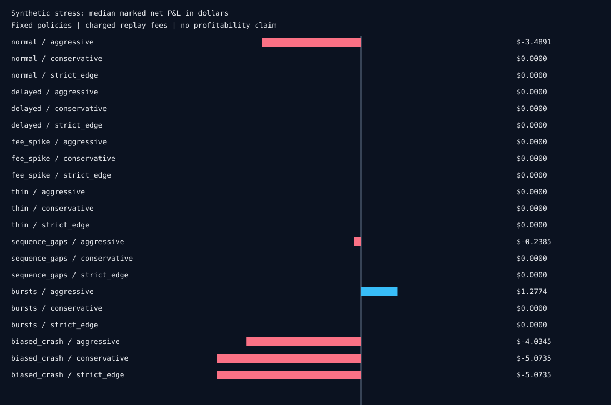

# Synthetic execution stress

Passing means accounting and risk invariants held. It does not establish live readiness or profitability. Zero P&L can mean no trades. Remaining inventory is marked at available bid depth.

| Scenario | Fixed policy | Paths | Median net P&L ($) | Worst ($) | Profitable paths | Maximum drawdown ($) |
|---|---|---:|---:|---:|---:|---:|
| normal | aggressive | 16 | -3.4891 | -5.8511 | 6 | 21.3391 |
| normal | conservative | 16 | 0.0000 | 0.0000 | 0 | 0.0000 |
| normal | strict_edge | 16 | 0.0000 | 0.0000 | 0 | 0.0000 |
| delayed | aggressive | 16 | 0.0000 | 0.0000 | 0 | 0.0000 |
| delayed | conservative | 16 | 0.0000 | 0.0000 | 0 | 0.0000 |
| delayed | strict_edge | 16 | 0.0000 | 0.0000 | 0 | 0.0000 |
| fee_spike | aggressive | 16 | 0.0000 | 0.0000 | 0 | 0.0000 |
| fee_spike | conservative | 16 | 0.0000 | 0.0000 | 0 | 0.0000 |
| fee_spike | strict_edge | 16 | 0.0000 | 0.0000 | 0 | 0.0000 |
| thin | aggressive | 16 | 0.0000 | 0.0000 | 0 | 0.0000 |
| thin | conservative | 16 | 0.0000 | 0.0000 | 0 | 0.0000 |
| thin | strict_edge | 16 | 0.0000 | 0.0000 | 0 | 0.0000 |
| sequence_gaps | aggressive | 16 | -0.2385 | -3.6443 | 5 | 51.6964 |
| sequence_gaps | conservative | 16 | 0.0000 | 0.0000 | 0 | 0.0000 |
| sequence_gaps | strict_edge | 16 | 0.0000 | 0.0000 | 0 | 0.0000 |
| bursts | aggressive | 16 | 1.2774 | -4.9427 | 9 | 10.4564 |
| bursts | conservative | 16 | 0.0000 | 0.0000 | 0 | 0.0000 |
| bursts | strict_edge | 16 | 0.0000 | 0.0000 | 0 | 0.0000 |
| biased_crash | aggressive | 16 | -4.0345 | -6.9843 | 0 | 9.6980 |
| biased_crash | conservative | 16 | -5.0735 | -5.7217 | 0 | 6.5628 |
| biased_crash | strict_edge | 16 | -5.0735 | -5.7217 | 0 | 6.5628 |

## Assumptions

- Toy bounded random-walk latent price and noisy quote; forecast observes synthetic latent state, never future outcomes
- Fixed policies and separate seed schedule; not historical out-of-sample evidence or calibrated alpha
- Periodic taker exits; no maker queue, market impact, binary resolution, gas, borrow or real network feed
- Flat replay fees; a delayed scenario exceeds book freshness, but does not model a calibrated price-latency relationship
- Remaining inventory is marked conservatively at fresh bid depth; P&L includes charged fees
- Passing means engine accounting and configured limits held; losses are reported and do not fail the correctness gate

[Raw paths, rejections and checks](simulations.json). [Methods and source inspiration](../docs/SIMULATIONS.md).
