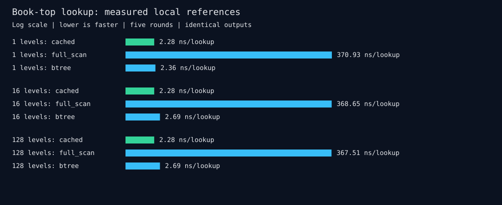

# Measured comparisons

We compare our cached best-price lookup against explicitly implemented full-scan and BTree references. This is an operation comparison on identical synthetic books, not a competitor engine or HRT result.

64 markets, 1,001 possible price slots, 512 lookups per timed batch, 100 warmup batches, 500 samples per backend and five rounds. Backend order rotates each round. Query order is deterministic and identical across backends. Every queried best bid/ask is checked for equality before timing. Raw batch times are retained.

| Levels per side | Cached median range ns/lookup | Full scan / cached median ratio range | BTree / cached median ratio range |
|---|---:|---:|---:|
| 1 | 2.28–6.84 | 54.26–171.63x | 0.35–1.04x |
| 16 | 2.20–2.28 | 158.59–165.63x | 1.18–1.22x |
| 128 | 2.20–2.28 | 158.84–165.24x | 1.18–1.22x |

## What we measured faster

Compact correctness profile. Timings are diagnostic; no optimized performance claim is established.

Ratios greater than one mean cached lookup was faster in that round. Ranges are observed round-to-round variation, not statistical confidence intervals. These are amortized batch values, not individual lookup latency percentiles. Setup, snapshots, updates, matching, feed/network latency and durable writes are excluded. Cached metadata avoids searching; maintaining that cache has a separate cost. No CPU pinning or hardware performance counters were used.

No claim is made that we beat hftbacktest, Barter, the Polymarket client or HRT: no comparable whole-system implementation/data was run. Packed quantization storage reductions are reported separately; smaller weights do not imply faster or more accurate trading.

Reproduce: make compare. Raw samples: [comparison.json](comparison.json). References: [COMPARISONS.md](COMPARISONS.md).
